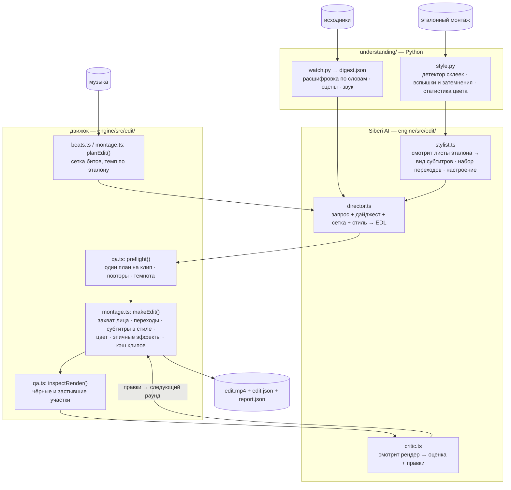

# Архитектура

promptcut — движок рендера, которым управляет один JSON-контракт, **EDL** (Edit Decision List, лист монтажных решений), а дирижирует LLM со зрением — **Siberi AI**. Siberi читает эталонный монтаж, пишет EDL и проверяет готовый рендер; движок превращает EDL в пиксели. Любой ИИ-шаг может упасть или быть пропущен, не роняя остальные, — эта цепочка запасных путей сделана намеренно.



Цикл принадлежит `conductor.ts`; его вызывают и `server.ts` (веб), и `cli.ts make`.

## EDL

`engine/src/edit/edl.ts`. Режиссёр никогда не имеет дела с графами фильтров, частотой кадров и геометрией кадрирования — он выбирает, *какая секунда исходника* встаёт на *какую склейку*, как склейка входит, и несколько акцентов:

```ts
interface EdlClip {
  srcOffset: number;                 // секунды от начала исходника
  camera?: "auto" | "face" | "whip" | "push";
  transition?: "cut" | "flash" | "zoom" | "whip" | "shake" | "glitch" | "blur" | "dip";
  epic?: boolean;                    // кульминация: вспышка + хрома + зум-удар + подъём музыки
  flash?: boolean;  chroma?: number; // дополнительные акценты
  accent?: string[];                 // слово(а) в акцентном цвете
  sub?: ClipCue;                     // разрешённые слова для этого клипа
  note?: string;                     // объяснение режиссёра (рендер его игнорирует)
}
interface Edl {
  source; music; maxDuration?; format?;
  grade?: string;                    // цепочка фильтров ffmpeg
  subtitle?: SubtitleStyle;          // вид субтитров эталона
  cutSteps?: [chorus, build, verse]; // долей на склейку — темп
  transcript?: string;               // путь, чтобы при доработке заново вывести слова сдвинутых клипов
  clips: EdlClip[];
}
```

Готовый монтаж записывает свой **разрешённый** EDL (каждое смещение, переход, слово и позицию на таймлайне) в `edit.json`. Так у доработки и у раунда критика есть точные исходные данные, а законченный монтаж перерисовывается детерминированно.

## Этап 1 — понимание (Python)

- **`watch.py`** → `aivm/`: `ingest.py` (yt-dlp или локальный файл), `transcribe.py` (faster-whisper с метками слов; CUDA с откатом на CPU на весь прогон, а не только на загрузку модели), `audio_analysis.py` (секции, энергия, темп), `visual.py` (смены сцен и контактные листы), `digest.py` → `digest.json`. Готовый дайджест того же файла переиспользуется.
- **`style.py`** измеряет эталон: таймкоды склеек — детектором по разнице кадров и гистограмм относительно локального уровня движения (scene score у ffmpeg пропускает большинство склеек в тёмных, обработанных монтажах), среднюю длину плана, частоту вспышек и уходов в чёрное на склейках и цветокоррекцию под его яркость, насыщенность и контраст.

## Этап 2 — Siberi

`llm.ts` — единственный транспорт: `ask(system, user, log, {image})` → `POST /generate {wait:false, imageBase64?}` → опрос `GET /result/:taskId`. Одна картинка на запрос, поэтому всё визуальное складывается в подписанные контактные листы в `sheets.ts` (кадры ffmpeg → подписи `drawtext` → `tile`). `askJson()` вытаскивает JSON-объект из болтливых ответов и один раз переспрашивает, если его нет. Системные промпты лежат в `engine/prompts/*.md` и перечитываются на каждый вызов.

- **Стилист** (`stylist.ts`, промпты `stylist-look.md`, `stylist-transitions.md`). Лист 1: двенадцать кадров из середины планов, где субтитры дорисованы полностью → шрифт субтитров (из каталога стандартных шрифтов Windows), размер, трекинг, цвета, акцентный цвет, обводка, тень и свечение, позиция, анимация и строка о настроении. Лист 2: ряды исходных кадров вокруг пяти склеек (`A-2 … A+7`) → тип перехода у каждой; вместе с измеренной частотой вспышек и затемнений даёт набор переходов. Итог — `StyleProfile`, закэшированный по хешу файла эталона.
- **Режиссёр** (`director.ts`, `system-prompt.md`). `directCuts()` получает запрос, таблицу сетки битов, дайджест (или горячие точки движения) и стиль словами («повтори ИМЕННО этот набор переходов») и возвращает по клипу на склейку; `sanitizeClips()` зажимает значения и приводит типы. `directReplace()` подбирает новые моменты вместо отклонённых клипов, видя уже использованные. `directRefine()` применяет инструкцию человека, тоже с дайджестом.
- **Критик** (`critic.ts`, `critic.md`): по кадру на клип (момент, когда субтитр почти дорисован), до 24 штук, с четырьмя кадрами эталона первым рядом `REF`, плюс таблица клипов, текущий стиль и находки предпроверки. Возвращает `score`, проблемы и правки на языке движка; `parseVerdict()` отбрасывает всё, что вне допустимых значений или неизвестно.

## Этап 3 — движок рендера

`montage.ts: makeEdit()`:

1. **Сетка склеек.** `beats.ts` (music-tempo) даёт BPM, доли и огибающую громкости; склейки попадают в доли, каждые `cutSteps[band]` долей. С эталоном `stepsFor()` переводит его среднюю длину плана в доли *этого* трека.
2. **Решения по клипам** — из EDL или в автоматическом режиме (`moments.ts` выбирает по движению, самый громкий участок — эпичный, переходы раздаёт `assignTransitions()` по набору из стиля).
3. **Кэш клипов.** Ключ клипа — хеш всего, что определяет его пиксели: окно исходника, камера, переход на входе и выходе, акценты, слова, стиль субтитров, цвет, формат, настройки кодека. Попадания копируются; слежение за лицом и рендер — только для промахов. Именно это делает раунды критика дешёвыми.
4. **Захват лица.** `face_track.py` (YuNet через OpenCV; запасной вариант — MediaPipe) обрабатывает пачки отрезков через stdin/stdout и возвращает центр и размер лица на каждый отсчёт. `buildFollowCrop()` сглаживает траекторию и подбирает кадр примерно в 4 ширины лица, так что даже маленькая веб-камера получает настоящий крупный план.
5. **ffmpeg на каждый клип**: кадрирование или наезд → цвет → переход на входе (`transitions.ts`) → эпичный зум-удар, хрома, вспышка → затухание на выходе, если *следующий* клип входит вспышкой или затемнением → вписывание в холст (квадрат или квадрат поверх размытой подложки для вертикали) → субтитры ASS (`subtitles.ts`: стиль, слой свечения, анимация). Всё это — на ограниченном пуле воркеров.
6. **Сборка**: склейка потоков без перекодирования, музыка с плавным подъёмом громкости на объединённых эпичных участках.

## Цикл дирижёра

`conductor.ts: conduct()`:

1. Измерить и прочитать эталон → `StyleProfile` (событие → карточка стиля в интерфейсе).
2. Собрать дайджест исходников (расшифровка сохраняется рядом с монтажом); спланировать сетку.
3. Режиссёр → EDL → `preflight()`: вокруг каждого клипа окно сканируется тем же детектором склеек; если внутрь попадает смена сцены в исходнике, клип сдвигается на ту сторону, где остаётся больше задуманного момента (`placeClear()`); повторы и почти чёрные клипы помечаются. Затем `grade.ts` измеряет кадры выбранных моментов и строит цепочку eq + colorbalance, ведущую их к измеренному виду эталона (`matchGrade()`: затемнение через гамму, относительный контраст, отношение насыщенности, теплота), с ограничениями — исходник стилизуется, а не уничтожается.
4. Рендер раунда *r* → `inspectRender()` (blackdetect и freezedetect) → критик.
5. Остановка, если оценка ≥ цели (8,5), раунды кончились, раунд стал хуже или правки не изменили бы ни одного входа рендера. Иначе применяются: заплатки (камера, переход, эпичность), правки субтитров (с эталоном — только читаемость: размер, позиция, обводка, тень, свечение; шрифт и цвета — скопированный стиль), правки цвета (`tweakGrade()` меняет `eq` на месте, оставляя остальную цепочку) и замены — выбор режиссёра, который отклоняется и меняется на свежий неиспользованный момент (сначала речь), если пересекается с уже занятым окном. Сдвинутые клипы снова проходят предпроверку.
6. Раунд с лучшей оценкой копируется в `edit.mp4` / `edit.json`; `report.json` хранит оценку, проблемы и правки каждого раунда.

## Доработка

- **`directRefine()`** (основной путь): EDL готового монтажа + инструкция + дайджест исходников → полный массив клипов; клипы, которые сдвинулись, теряют сохранённые слова, и они заново выводятся из сохранённой расшифровки.
- **`refine.ts: refine()`** (запасной путь): детерминированный разбор типовых случаев (темнее или светлее, больше или меньше вспышек, хрома, «замени момент на N–M с») — только когда Siberi недоступна.

## Структура проекта

```
engine/
  prompts/          system-prompt.md (режиссёр) · stylist-look.md · stylist-transitions.md · critic.md
  public/index.html веб-интерфейс: зоны загрузки, лог через SSE, карточка стиля, раунды проверки
  python/           face_track.py + models/ (YuNet, MediaPipe landmarker)
  src/
    env.ts          загрузка .env
    understand.ts   мост к understanding/: скачивание, measureStyle, runDigest
    server.ts       Express: /api/generate (дирижёр), /api/refine, SSE
    config.ts       форматы, качество рендера, цветокоррекции
    ffmpeg.ts       запуск процессов + замер длительности
    edit/
      conductor.ts  цикл: стиль → режиссура → предпроверка → рендер → проверка → правки
      stylist.ts    Siberi читает эталон
      director.ts   Siberi пишет, заменяет и дорабатывает EDL
      critic.ts     Siberi проверяет рендер
      llm.ts        транспорт Siberi (текст + одна картинка)
      sheets.ts     подписанные контактные листы и ленты склеек
      qa.ts         детектор склеек, предпроверка, проверка рендера
      montage.ts    рендер (planEdit, makeEdit, кэш клипов)
      grade.ts      цвет под эталон
      transitions.ts, subtitles.ts, facelock.ts, beats.ts, moments.ts, refine.ts, edl.ts
      cli.ts        make · style · plan · render
  test/             наборы node:test (npm test)
understanding/
  watch.py          исходники → digest.json + контактные листы
  style.py          эталон → измеренный стиль
  aivm/             ingest, transcribe, audio_analysis, visual, digest, subtitles
```
