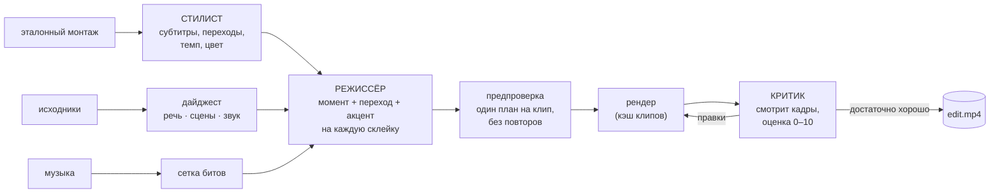

# promptcut

**Дайте ему эталонный монтаж, исходное видео и трек — получите монтаж в бит, который режет, делает переходы и субтитры как в эталоне.**

promptcut — небольшой видеоредактор со своим характером, которым от начала до конца дирижирует LLM со зрением. **Siberi AI** смотрит эталонный монтаж и записывает его стиль: как сделаны склейки, как выглядят субтитры, в каком темпе идёт нарезка. Затем режиссирует монтаж на ваших исходниках бит за битом и проверяет готовый рендер кадр за кадром, отправляя правки, пока монтаж не станет хорошим. Пиксельную работу делает локальный движок рендера: слежение за лицом с точностью до кадра, стилизованные анимированные субтитры, восемь видов переходов в бит и кинематографичная цветокоррекция.

```
собери самые смешные моменты
```
```
эпичный клип, финал — на дропе
```

…и он режет ролик, критикует его и режет заново.

## Зачем это

Большинство «ИИ-видео» инструментов либо выдают шаблонные автонарезки без понимания *смысла*, либо просят описать монтаж в чате и возвращают чёрный ящик. promptcut чисто делит задачу. Python-конвейер **понимания** превращает исходники в то, что LLM действительно может прочитать: дайджест с таймкодами — расшифровка, смены сцен, структура звука, а не сырые пиксели. Движок **рендера** на TypeScript превращает маленький явный JSON-контракт (EDL) в настоящее видео. А LLM делает только то, в чём сильна: *читает стиль*, *выбирает моменты по смыслу* и *оценивает результат* — на языке самого движка. До ffmpeg, расчётов таймингов и пикселей она не дотрагивается.

## Монтажом дирижирует Siberi



1. **Стилист** (`engine/src/edit/stylist.ts`). `understanding/style.py` измеряет эталон: таймкоды склеек, длину плана, частоту вспышек и затемнений, статистику цвета. Затем Siberi *смотрит* два подписанных контактных листа: кадры из середины планов (→ шрифт субтитров, размер, трекинг, цвета, акцентный цвет, свечение, позиция, анимация) и покадровые ленты вокруг склеек (→ какой переход у каждой склейки). Итог — один `StyleProfile`, закэшированный по содержимому эталона.
2. **Режиссёр** (`director.ts`) читает ваш запрос, дайджест исходников, сетку битов и профиль стиля и пишет EDL: какой момент встаёт на какую склейку, как склейка входит (повторяя набор переходов эталона), какое слово реплики получает акцентный цвет, где кульминация.
3. **Предпроверка** (`qa.ts`) — детерминированные проверки без LLM: клип, который перескакивает через смену сцены в исходнике, сдвигается на одну её сторону; повторы и почти чёрные кадры помечаются.
4. **Рендер** (`montage.ts`): камера с захватом лица, субтитры в стиле эталона, переходы, цвет, эпичные эффекты, подъём музыки. Каждый клип кэшируется по всему, что определяет его пиксели, поэтому раунд правок перерисовывает только изменившиеся клипы.
5. **Критик** (`critic.ts`). Siberi проверяет по одному кадру на клип (в первом ряду — кадры эталона для сравнения), таблицу клипов и находки предпроверки, ставит оценку и возвращает правки на языке движка: заменить этот момент, зафиксировать камеру на лице, сменить переход, субтитры крупнее, ниже или с обводкой, цвет светлее. **Дирижёр** (`conductor.ts`) применяет их и перерисовывает — до N раундов, останавливаясь раньше, если критик доволен или ничего бы не поменялось, — и оставляет раунд с лучшей оценкой.

Каждый шаг Siberi деградирует мягко: нет ключа или ответа — детерминированный путь движка (моменты по движению, оформление по умолчанию) всё равно собирает монтаж.

## Возможности

- **Перенос стиля, который действительно читает эталон.** Темп, переходы и вид субтитров копируются с эталона, а не приближаются пресетом.
- **Сетка склеек в бит** (`beats.ts`): темп и огибающая громкости. Склейки попадают в доли, плотность следует песне (куплеты дышат, дропы режутся быстро), а средняя длина плана — эталону.
- **Восемь переходов** (`transitions.ts`): склейка, белая вспышка, зум-удар, рывок с размытием движения, тряска, RGB-глитч, проявление из размытия, уход в чёрное. Сделаны как эффекты входа и выхода, поэтому клипы независимы, кэшируются и рендерятся параллельно.
- **Стилизованные субтитры** (`subtitles.ts`): шрифт, размер, трекинг, цвета, акцентное слово, обводка и тень, мягкое свечение, позиция и анимация — караоке-заливка, появление по словам, печатная машинка, одно слово крупно, проявление фразы. Тонким стилям добавляется мягкая тёмная подложка, чтобы они читались на светлых кадрах. Тайминги слов — из faster-whisper.
- **Цвет под эталон** (`grade.ts`). Кадры, которые войдут в монтаж, измеряются и подтягиваются к яркости, относительному контрасту, насыщенности и теплоте эталона, а не получают одну фиксированную «эталонную» коррекцию.
- **Камера с захватом лица.** Детектор лиц YuNet (`engine/python/face_track.py`, находит даже маленькую веб-камеру в стриме) → сглаженный кадрирующий проход через `sendcmd` под «голову и плечи» (`facelock.ts`); если лица нет — мягкий наезд.
- **«Эпичные» биты**: вспышка, хроматический всплеск, зум-удар и подъём громкости музыки.
- **Итеративная доработка.** «Сделай первую половину спокойнее, самый сильный момент — на дроп» → режиссёр правит EDL, видя дайджест исходников, и монтаж перерисовывается.
- **Цикл самопроверки.** Рендер оценивается относительно запроса и эталона; плохие кадры, нечитаемые субтитры и решения не в стиле исправляются до того, как вы их увидите.

Схема EDL и каждый этап подробно — в **[ARCHITECTURE.md](ARCHITECTURE.md)**.

## От автоматизации браузера к API

Сначала режиссёр не вызывал настоящий API. Первая версия управляла безголовым браузером в бесплатном веб-чате (Mistral): ноль затрат, без ключа API и быстрый способ проверить *идею*. Но она постоянно ломалась: селекторы DOM уплывали, сессии истекали посреди рендера, запустить её без присмотра или параллельно было нельзя.

Исправил транспорт, а не архитектуру: `engine/src/edit/llm.ts` ходит в [**Siberi AI**](https://github.com/LDRION/siberi) (мой LLM-шлюз) по простому асинхронному протоколу `POST /generate` → опрос `GET /result/:taskId`, с повторами, отступлением при 429 и слоем извлечения JSON, который терпит болтливые ответы модели. Граница всегда была просто `(system, user[, image]) → text`, поэтому дать модели *зрение* — по одной картинке на запрос через `imageBase64` — тоже оказалось сменой транспорта. Это открыло стилиста и критика, не затронув движок рендера.

## Быстрый старт — веб-интерфейс

```powershell
copy .env.example .env      # впишите SIBERI_API_KEY
cd engine
npm install
npm run web
#    → http://localhost:5174
```

Перетащите эталонный монтаж, исходники и трек (файлы или ссылки), при желании напишите запрос и нажмите **«Собрать эдит»**. Страница показывает стиль эталона, который прочитала Siberi (шрифты, цвета, набор переходов, листы, на которые она смотрела), и каждый раунд проверки — с оценкой, проблемами и правками. После этого монтаж можно доработать свободными инструкциями в **«Доработать»**.

## Быстрый старт — CLI

```powershell
cd engine
# Полный дирижируемый конвейер: стиль → режиссура → рендер → проверка → правки
npm run make -- --style ..\media\ref.mp4 --source ..\media\work.mp4 --music ..\media\track.mp3 `
                --prompt "эпичный клип, финал — на дропе" --max 30 --format vertical
#    → output/make-*/edit.mp4 (+ edit.json, style.json, report.json, листы проверки)

# Только прочитать стиль эталона
npm run style -- ..\media\ref.mp4

# Ручная режиссура: спланировать сетку, написать EDL руками, отрендерить
npm run plan -- --music ..\media\track.mp3 --max 20
npm run render -- --edl ..\edl.json

# Совсем без LLM: моменты выбираются по движению
npm run render -- --music ..\media\track.mp3 --source ..\media\work.mp4 --max 20
```

Параметры `make`: `--rounds N` (раундов правок после первого рендера, по умолчанию 2), `--review 0` (без критика), `--format square|vertical`.

## EDL — контракт между мозгом и руками

```jsonc
{
  "source": "media/work.mp4",
  "music":  "media/track.mp3",
  "maxDuration": 20,
  "subtitle": { "font": "Century Gothic", "sizePct": 3.2, "spacing": 0.3,
                "accentColor": "#3E9346", "glow": true, "animation": "reveal" },
  "clips": [                       // по записи на каждую склейку сетки битов
    { "srcOffset": 12.4, "transition": "whip", "note": "фраг — сильное горизонтальное движение" },
    { "srcOffset": 47.0, "transition": "zoom", "epic": true, "note": "здесь бьёт дроп" },
    { "srcOffset": 88.1, "camera": "face", "accent": ["мальчики"], "note": "реакция" }
  ]
}
```

`camera`: `auto` · `face` · `whip` · `push`. `transition`: `cut` · `flash` · `zoom` · `whip` · `shake` · `glitch` · `blur` · `dip`. Полная схема: `engine/src/edit/edl.ts`.

## Переменные окружения

| Переменная | Обязательна | По умолчанию | Назначение |
|---|---|---|---|
| `SIBERI_API_KEY` | для ИИ | — | Ключ Siberi AI: стилист, режиссёр, критик. Без него движок рендерит в автоматическом режиме |
| `SIBERI_BASE_URL` | нет | `http://127.0.0.1:5005/api/v1/ai` | Адрес своего сервера Siberi |
| `PROMPTCUT_WHISPER` | нет | `small` | Размер модели faster-whisper для дайджеста исходников |
| `PORT` | нет | `5174` | Порт веб-интерфейса |

Значения кладутся в `.env` в корне репозитория (см. `.env.example`) — он читается при старте; переменные, уже заданные в оболочке, главнее.

## Требования

- **ffmpeg и ffprobe** в `PATH` (с libass — в стандартных полных сборках он есть).
- **Node 20.12+** для движка, **Python 3.11+** для конвейера понимания: `python -m venv understanding\.venv`, затем `understanding\.venv\Scripts\python.exe -m pip install -r understanding\requirements.txt`.
- Свой сервер [Siberi](https://github.com/LDRION/siberi), запущенный с `PORT=5005`, и его ключ — для ИИ-шагов.
- Захват лица работает в том же venv (YuNet из OpenCV; MediaPipe — запасной вариант). Без него камера переходит на центрированный наезд.
- По желанию: **Deno** в `PATH` — `yt-dlp` нужна среда JS, чтобы надёжно скачивать ссылки YouTube (`winget install -e -s winget DenoLand.Deno`).

## Тесты

```powershell
cd engine
npm test          # юнит-тесты + каждый фильтр перехода проверяется настоящим ffmpeg
npm run typecheck
```

## Состояние и ограничения

Это рабочий личный инструмент, а не отполированный продукт:

- **Siberi видит одну картинку за запрос**, поэтому стилист и критик смотрят на сетки кадров, а не на видео. Свойства, видные только в движении (точная анимация субтитров, ритм тряски), выводятся по стоп-кадрам и покадровым лентам.
- **Критик может неверно прочитать лист** (например, назвать видимое лицо «пропавшим»). Поэтому его правки ограничены: за раунд заменяется не больше четверти моментов, детерминированные находки идут первыми, вид субтитров эталона зафиксирован, побеждает раунд с лучшей оценкой — плохая проверка не может ухудшить итоговый монтаж.
- **Источники «картинка в картинке»** (веб-камера стримера в углу): кадр захвата лица квадратный, поэтому вокруг маленькой веб-камеры видны полосы игрового экрана.
- **ИИ-раунд занимает время.** Каждый вызов Siberi — 10–60 с; полный дирижируемый монтаж с двумя раундами проверки — примерно шесть вызовов сверх расшифровки и рендера.
- **Одна машина, один процесс.** Задачи живут в `Map` в памяти `engine/src/server.ts` — перезапуск сервера теряет прогресс текущих задач.
- **Ответ LLM приводится к норме, а не строго валидируется**: режиссёр и критик зажимаются и приводятся к корректным правкам EDL. Это ставит «всегда выдать *какой-то* монтаж» выше отказа на небрежном ответе.
- Шрифты субтитров — стандартный набор Windows; на других системах libass нужны такие же шрифты.

## Происхождение

promptcut объединил два моих более ранних проекта: **AIvideomusic** (конвейер понимания видео) и рендер монтажа из **faceless-factory**. Понимание питает монтаж — в этом вся идея.

## Лицензия

[MIT](LICENSE) © 2026 LDRION
